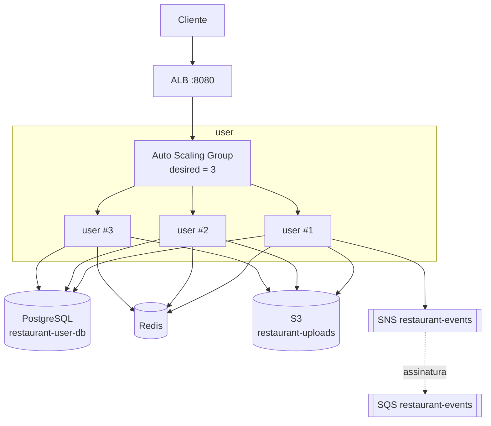

# Sistema de Restaurante

Projeto de **treino de System Design e tecnologias**, criado para estudar na prática como aplicações reais são estruturadas: microsserviços, filas, cache, banco de dados, armazenamento de arquivos, load balancing e infraestrutura como código.

A AWS é simulada localmente com o [Floci](https://floci.io/), um emulador open source que expõe APIs compatíveis com AWS (EC2, RDS, ElastiCache, S3, SNS, SQS, ELBv2, Auto Scaling e outras). Assim é possível aprender Terraform e os serviços da AWS sem custo e sem depender da nuvem real.

> Este projeto tem fins **didáticos**. Credenciais, rede e configurações não são adequadas para produção.

## Objetivos

- Praticar arquitetura de microsserviços com NestJS e TypeScript.
- Aprender AWS usando o Floci como emulador local.
- Provisionar toda a infraestrutura com Terraform.
- Entender o caminho de uma requisição: cliente → load balancer → instâncias → banco/cache/fila.
- Simular padrões de aplicações de grande escala: réplicas, health checks, auto scaling, banco por serviço e eventos assíncronos.

## Tecnologias

| Camada | Tecnologia |
| --- | --- |
| Aplicação | NestJS 11, TypeScript, TypeORM |
| Banco relacional | PostgreSQL 16 |
| Cache | Redis 7 (ElastiCache) |
| Mensageria | SNS + SQS |
| Arquivos | S3 |
| Infraestrutura | Terraform (provider AWS 6.x) |
| AWS local | Floci 2.3.0 |
| Containers | Docker e Docker Compose |
| Testes | Jest |

## Arquitetura

O domínio é dividido em três microsserviços:

| Serviço | Responsabilidade | Status |
| --- | --- | --- |
| `user` | Usuários, clientes, entregadores e endereços | Implementado |
| `auth` | Autenticação e autorização | Estrutura inicial |
| `restaurant` | Restaurantes, cardápios e pedidos | Estrutura inicial |

Cada microsserviço é planejado para ter seu próprio banco (`database per service`), sua própria imagem/AMI, seu próprio ALB e um Auto Scaling Group com 3 réplicas. O serviço `user` já roda nesse modelo; os demais seguem o mesmo padrão.



O diagrama também está disponível em `docs/mermaid-diagram.png`.

### Infraestrutura provisionada

| Recurso | Configuração |
| --- | --- |
| VPC | `10.20.0.0/16` |
| Subnets | `10.20.1.0/24` (us-east-1a) e `10.20.2.0/24` (us-east-1b) |
| ALB | Application Load Balancer em `localhost:8080` |
| Auto Scaling | `min=1`, `desired=3`, `max=5` |
| RDS | PostgreSQL `restaurant-user-db` na porta `17001` |
| ElastiCache | Redis `restaurant-cache` na porta `16379` |
| S3 | Bucket `restaurant-uploads` |
| SNS | Tópico `restaurant-events` |
| SQS | Fila `restaurant-events` |

### Portas locais

| Porta | Serviço |
| --- | --- |
| `4566` | API do Floci |
| `8080` | ALB do microsserviço `user` |
| `17001-17099` | Proxies de PostgreSQL (RDS) |
| `16379-16399` | Proxies de Redis (ElastiCache) |
| `2200-2299` | SSH das instâncias EC2 emuladas |
| `3000` | Porta interna das aplicações dentro das instâncias |

As aplicações escutam em `3000` dentro das instâncias. O acesso externo passa exclusivamente pelo ALB, então a porta `3000` não é publicada no host.

## Estrutura do projeto

```text
.
├── auth/                  # Microsserviço de autenticação (estrutura inicial)
├── aws/                   # Pacote compartilhado de integração com AWS
├── docs/                  # Diagramas
├── infra/                 # Terraform
│   ├── floci/             # Catálogo de AMIs do Floci
│   ├── main.tf            # VPC, subnets, RDS, Redis, S3, SNS, SQS, ALB, ASG
│   ├── outputs.tf
│   ├── provider.tf
│   └── variables.tf
├── restaurant/            # Microsserviço de restaurante (estrutura inicial)
├── user/                  # Microsserviço de usuários (implementado)
├── docker-compose.yml
└── README.md
```

O pacote `aws/` centraliza a integração com S3, SNS, SQS e EC2 para ser reutilizado pelos serviços.

## Como executar

### Pré-requisitos

- Docker Desktop com Docker Compose
- Node.js 22 (apenas para desenvolvimento local dos serviços)
- Terraform não precisa estar instalado no host: os comandos rodam no container `hashicorp/terraform`.

### Subir tudo

```bash
docker compose up -d --build
```

Esse comando:

1. Sobe o Floci.
2. Constrói a imagem `restaurant-app:latest`.
3. Executa `terraform init` e `terraform apply` dentro do container.

Acompanhe a infraestrutura:

```bash
docker compose logs -f terraform
```

Quando o apply terminar:

```bash
curl http://localhost:8080
# Hello World!
```

### Verificar as réplicas e a saúde dos targets

```bash
# Credenciais fictícias usadas pelo Floci
export AWS_ACCESS_KEY_ID=test
export AWS_SECRET_ACCESS_KEY=test
export AWS_DEFAULT_REGION=us-east-1

# No PowerShell: $env:AWS_ACCESS_KEY_ID="test"; $env:AWS_SECRET_ACCESS_KEY="test"; $env:AWS_DEFAULT_REGION="us-east-1"

aws --endpoint-url http://localhost:4566 autoscaling describe-auto-scaling-groups \
  --auto-scaling-group-names restaurant-user

TG_ARN=$(aws --endpoint-url http://localhost:4566 elbv2 describe-target-groups \
  --names restaurant-user \
  --query 'TargetGroups[0].TargetGroupArn' \
  --output text)

aws --endpoint-url http://localhost:4566 elbv2 describe-target-health \
  --target-group-arn "$TG_ARN"
```

### Reaplicar mudanças de infraestrutura

O serviço `terraform` do Compose é de execução única. Depois de alterar arquivos em `infra/`, rode:

```bash
docker compose run --rm terraform
```

### Desenvolvimento local do serviço `user`

Com o Floci e o banco no ar:

```bash
cd user
npm install
npm test
npm run start:dev
```

### Testes e validações

```bash
cd user && npm test
docker compose run --rm terraform sh -c "terraform fmt -check -recursive && terraform validate"
docker compose config --quiet
```

### Derrubar o ambiente

```bash
docker compose down
```

O estado do Floci fica no volume `floci-data`. Para apagar também os dados:

```bash
docker compose down -v
```

## Como adicionar um novo microsserviço

O padrão usado pelo `user` deve ser repetido para os próximos serviços:

1. **Crie a aplicação** (por exemplo, `payment/`) com NestJS e um `Dockerfile`.
   Use `ENTRYPOINT ["node", "dist/main.js"]`. O Floci preserva o `ENTRYPOINT` e substitui o `CMD` por `tail -f /dev/null`; por isso, um Dockerfile que só usa `CMD` não inicia a aplicação.
2. **Publique a imagem** adicionando um serviço de build no `docker-compose.yml`, por exemplo `payment-image`.
3. **Cadastre a AMI** em `infra/floci/ec2-image-catalog.yaml`, apontando `dockerImage` para a nova imagem.
4. **Crie a infraestrutura** em `infra/main.tf` seguindo o bloco do `user`:
   - `aws_launch_template` com a AMI do serviço;
   - `aws_lb_target_group` na porta `3000`;
   - `aws_lb` e `aws_lb_listener` em uma porta livre (`8081`, `8082`, ...);
   - `aws_autoscaling_group` com `desired_capacity = 3`.
5. **Crie o banco do serviço** com um `aws_db_instance` próprio (`restaurant-payment-db`) e o respectivo `db_name`.
6. **Use o S3 compartilhado** com um prefixo do serviço, por exemplo `payment/`.
7. **Configure as variáveis de ambiente** `DB_HOST=floci`, `DB_PORT`, `DB_NAME`, `AWS_ENDPOINT_URL=http://floci:4566`, etc.
8. **Exponha a porta do novo ALB** no `docker-compose.yml` e adicione um output com a URL.

## Estratégia de S3

O projeto usa **um bucket compartilhado**, `restaurant-uploads`, com prefixos por serviço:

```text
restaurant-uploads/
├── user/
├── auth/
└── restaurant/
```

Essa abordagem é suficiente para simular grande escala: o S3 escala independentemente do volume e evita a proliferação de buckets. Buckets separados só se justificam quando há diferenças de ciclo de vida, criptografia, retenção, compliance ou proprietário.

## Limitações do Floci

O Floci é um emulador, não a AWS real. Alguns pontos importantes:

- **Auto Scaling não reage a métricas de CPU.** O grupo mantém o `desired_capacity` (3), mas políticas de target tracking são armazenadas e não avaliadas.
- **Load balancers usam um socket por porta.** Por isso cada serviço usa uma porta de listener diferente (`8080`, `8081`, ...).
- **ALB exige duas subnets em AZs diferentes**, o que motivou a criação da subnet `10.20.2.0/24`.
- **O `CMD` do Dockerfile é substituído**, então use `ENTRYPOINT` para iniciar a aplicação.
- **Security groups não são aplicados como firewall** por padrão; as portas das instâncias também não são publicadas no host quando `FLOCI_SERVICES_EC2_PUBLISH_SECURITY_GROUP_PORTS=false`.
- O estado é persistido no volume `floci-data` e sobrevive a reinícios do container.

## Próximos passos

- Implementar `auth` e `restaurant` com seus próprios bancos e ALBs.
- Criar a subscription SNS → SQS e o consumer de eventos.
- Adicionar health checks específicos (`/health`) e observabilidade.
- Separar ambientes (`dev`/`staging`) com workspaces do Terraform.
- Evoluir o CI para validar testes, `terraform fmt` e `terraform validate`.